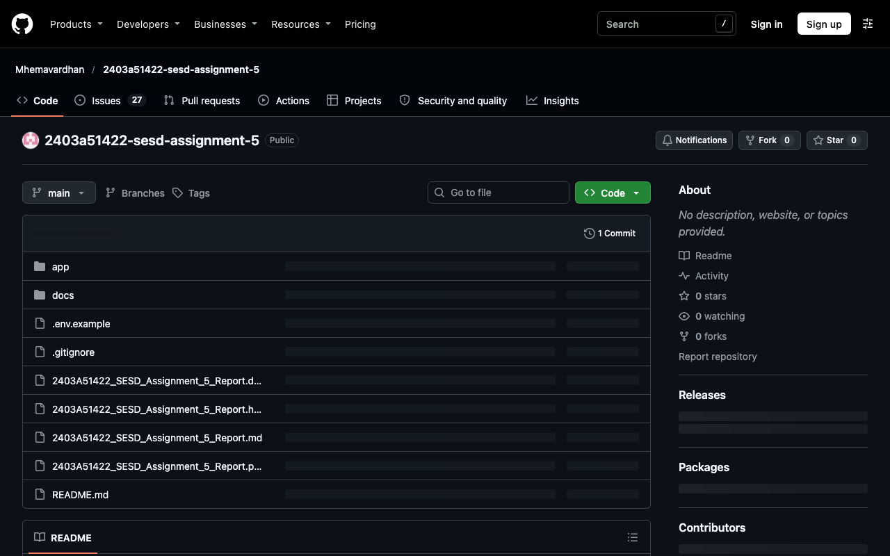
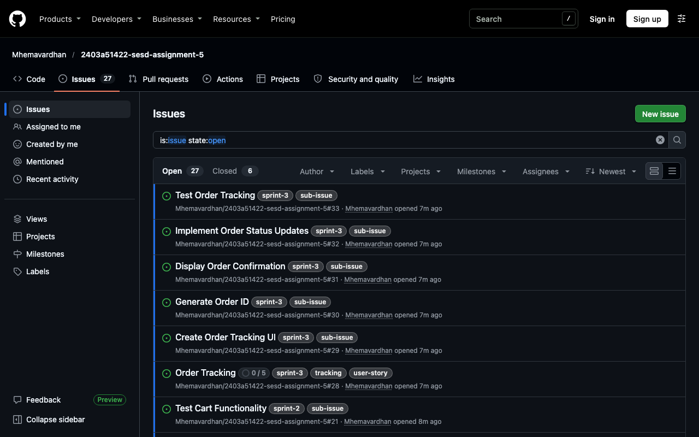
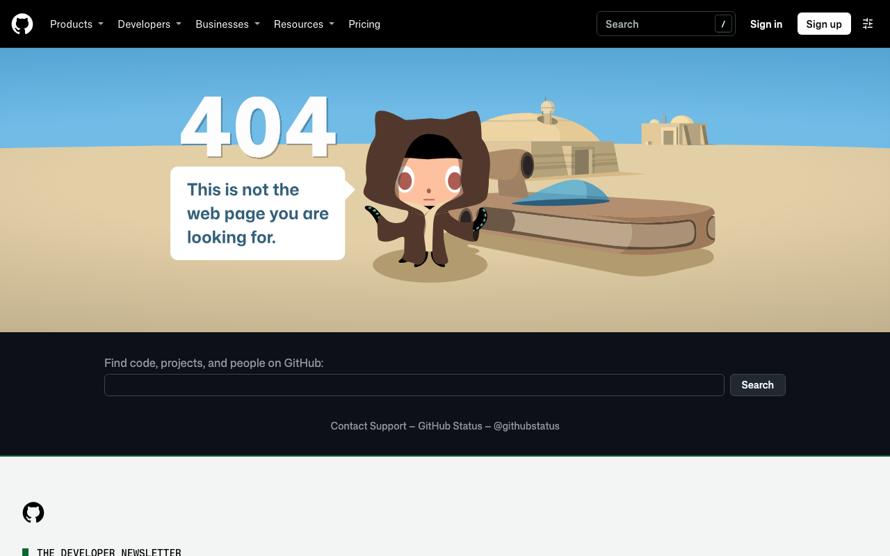
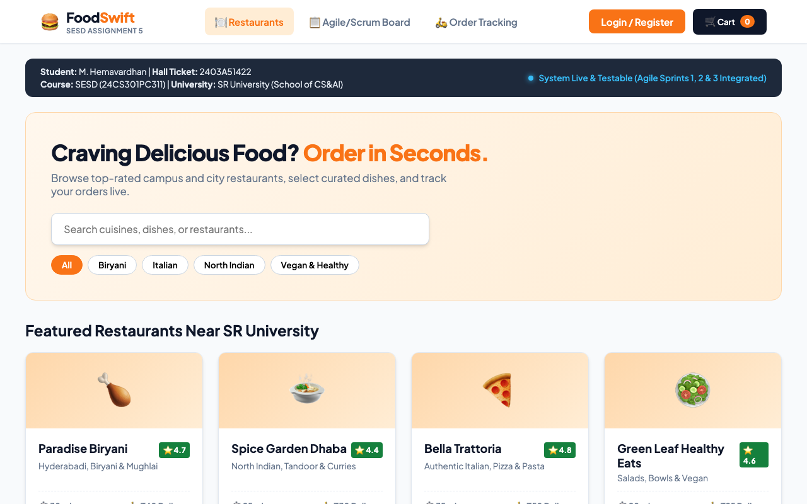

# Document 11: Implementation & Scrum Board Screenshots Index

**Project Title:** Online Food Ordering System — Agile/Scrum Simulation  
**Student Name:** M. Hemavardhan (2403A51422)  
**Subject:** Software Engineering and System Design (24CS301PC311)  
**Department of CSE | School of CS&AI | SR University**  
**Live Project URL:** [https://github.com/users/Mhemavardhan/projects/1](https://github.com/users/Mhemavardhan/projects/1)  
**Repository URL:** [https://github.com/Mhemavardhan/2403a51422-sesd-assignment-5](https://github.com/Mhemavardhan/2403a51422-sesd-assignment-5)  

---

## 1. Index of Implementation & Scrum Artifacts

This index catalogs each structural view of the GitHub Scrum workflow and the running Online Food Ordering application, detailing the purpose and academic relevance of each screen.

---

### Screenshot Catalog Table

| Figure # | Title | Screen Description & Components Shown | Local Artifact Path |
| :---: | :--- | :--- | :--- |
| **Fig 1** | **Repository Overview** | GitHub repository for `2403a51422-sesd-assignment-5`, Public visibility, student identity M. Hemavardhan. | `screenshots/01_github_repository.png` |
| **Fig 2** | **GitHub Issues & Backlog List** | Repository Issues page showing all 33 user stories and sub-issues. | `screenshots/02_github_issues_list.png` |
| **Fig 3** | **GitHub Project V2 Scrum Board** | "Online Food Ordering - Scrum Project" with custom fields (Status, Priority, Story Points, Iteration). | `screenshots/03_github_project_board.png` |
| **Fig 4** | **Web Application: Restaurant Catalog** | Responsive web app header with student banner, live search, cuisine filters, and restaurant cards. | `screenshots/04_app_catalog.png` |

---

## 2. Screenshot Previews

### Figure 1: GitHub Repository Overview

### Figure 2: GitHub Issues & Backlog List

### Figure 3: GitHub Projects Scrum Board & Backlog

### Figure 4: Running Web Application (Catalog & Student Banner)

