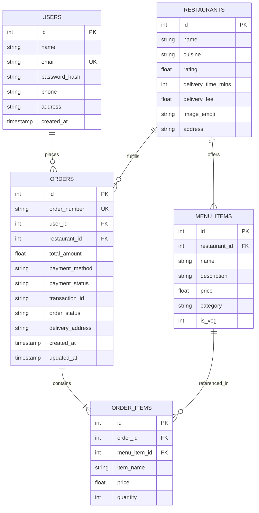

# Document 12: Software Architecture & System Design

**Project Title:** Online Food Ordering System — Agile/Scrum Simulation  
**Student Name:** M. Hemavardhan (2403A51422)  
**Subject:** Software Engineering and System Design (24CS301PC311)  
**Department of CSE | School of CS&AI | SR University**  

---

## 1. System Architectural Overview

The **FoodSwift Online Food Ordering System** follows a clean **Three-Tier Architecture** that enforces separation of concerns between client-side rendering, business logic enforcement, and persistent data storage.

```
+-------------------------------------------------------------------------+
|                          PRESENTATION LAYER (SPA)                       |
|   • HTML5 Responsive Layout        • Vanilla JavaScript (ES6+)          |
|   • Custom Modular CSS3 System    • Dynamic DOM Modals & Drawers        |
|   • Live Stepper & Toast System   • Embedded Kanban Scrum Board         |
+-------------------------------------------------------------------------+
                                    |
                           HTTP / REST (JSON)
                                    v
+-------------------------------------------------------------------------+
|                        APPLICATION LOGIC LAYER                          |
|   • Python HTTP Server Engine      • Salted SHA-256 Authentication      |
|   • Cart Validation & Calculation  • Mock Payment Gateway Processor    |
|   • Order State Transition Machine • CORS & Error Handling Middleware   |
+-------------------------------------------------------------------------+
                                    |
                            Parameterized SQL
                                    v
+-------------------------------------------------------------------------+
|                           DATA STORAGE LAYER                            |
|   • SQLite Relational Database (`food_ordering.db`)                     |
|   • Relational Integrity (Foreign Keys, Unique Constraints)             |
|   • Tables: `users`, `restaurants`, `menu_items`, `orders`, `order_items`|
+-------------------------------------------------------------------------+
```

---

## 2. Entity-Relationship (ER) Architecture



---

## 3. REST API Endpoint Specifications

| HTTP Method | Route Endpoint | Request Payload / Params | Response Status & Body | Description |
| :--- | :--- | :--- | :--- | :--- |
| `POST` | `/api/register` | `name`, `email`, `password`, `phone`, `address` | `201 Created` / `{"token", "user"}` | Registers a new student account |
| `POST` | `/api/login` | `email`, `password` | `200 OK` / `{"token", "user"}` | Verifies credentials, issues session token |
| `GET` | `/api/me` | Header: `Authorization: Bearer <token>` | `200 OK` / `{"user"}` | Returns current authenticated user profile |
| `GET` | `/api/restaurants` | *None* | `200 OK` / `{"restaurants": [...]}` | Retrieves list of all restaurants |
| `GET` | `/api/restaurants/:id/menu` | URL parameter: `restaurant_id` | `200 OK` / `{"restaurant", "menu"}` | Returns specific restaurant details and dishes |
| `POST` | `/api/checkout` | `restaurant_id`, `items`, `payment_method`, `delivery_address` | `201 Created` / `{"order_number", "transaction_id"}` | Validates cart, processes mock payment, creates order |
| `GET` | `/api/orders` | Header: `Authorization: Bearer <token>` | `200 OK` / `{"orders": [...]}` | Retrieves customer's past orders |
| `GET` | `/api/orders/:id/track` | URL parameter: `order_number` | `200 OK` / `{"order", "stages", "current_stage_index"}` | Returns real-time delivery status |
| `POST` | `/api/orders/:id/advance` | URL parameter: `order_number` | `200 OK` / `{"previous_status", "new_status"}` | Advances simulation status to next stage |

---

## 4. Security Architecture & Threat Mitigation

1. **Cryptographic Password Protection:** Passwords are never stored in plaintext. They are salted using a dedicated server salt and hashed via SHA-256 (`hashlib.sha256((password + salt).encode('utf-8')).hexdigest()`).
2. **SQL Injection Prevention:** All SQL queries use strictly parameterized queries (`?` placeholders) executed via `sqlite3.Cursor.execute()`, guaranteeing input sanitization.
3. **Cross-Site Scripting (XSS) Prevention:** Client-side user input is passed through an HTML entity escaping utility (`escapeHtml()`) before DOM insertion.
4. **Mock Payment Boundary:** No live banking or credit card secrets are accepted or transmitted, guaranteeing adherence to educational safety guidelines.
